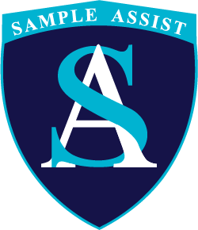

# Hey, I'm Jake 👋

**Product lead who still ships code.**

Head of Product @ [Innosano](https://innosano.com) | Founder @ [DigiWize](https://digiwize.solutions/) | CS @ UOW

> 🔒 Most of my code is in private repos. This is what's in them.

---

## What I'm building

### <a href="https://digiwize.solutions/"><picture><source media="(prefers-color-scheme: dark)" srcset="assets/digiwize-dark.svg"></picture></a> [DigiWize](https://digiwize.solutions/)

Engineering operations platform. It reports on delivery from the work itself, so nobody writes status updates.

- Delivery analytics: workload, flow, velocity and leaderboards
- Sprints, with capacity that accounts for leave and public holidays
- Incident management with SLA alerts
- Customer management, plus Freshdesk, Zendesk and Zoho integrations

 &nbsp;+ Hono · Drizzle · TanStack · Socket.IO

###  [GroundCtrl Sport](https://innosano.com/groundctrl-sport.html)

An Innosano product. Operations platform for sports organisations. I work as a forward deployed engineer, building modules with the customer.

- Ported the core modules to a React Native app
- Real-time messaging and group chats
- Rich-text notes, travel management and audit trails
- Zoom and Microsoft Teams calls

 &nbsp;+ Expo · Drizzle · Socket.IO

###  [Sample Assist](https://www.sampleassist.com)

An Innosano product. Workplace drug testing platform, and where I started as an intern.

- Built Secure Assist, a digital chain of custody for samples
- Set up the CI/CD pipelines the team still runs on
- Shipped the Welcome Assist check-in kiosk
- Built and deployed the T-Core website

---

## Toolbox

Also: React Native / Expo, Hono, Drizzle ORM, Socket.IO, TanStack, shadcn/ui, Turborepo, Playwright
